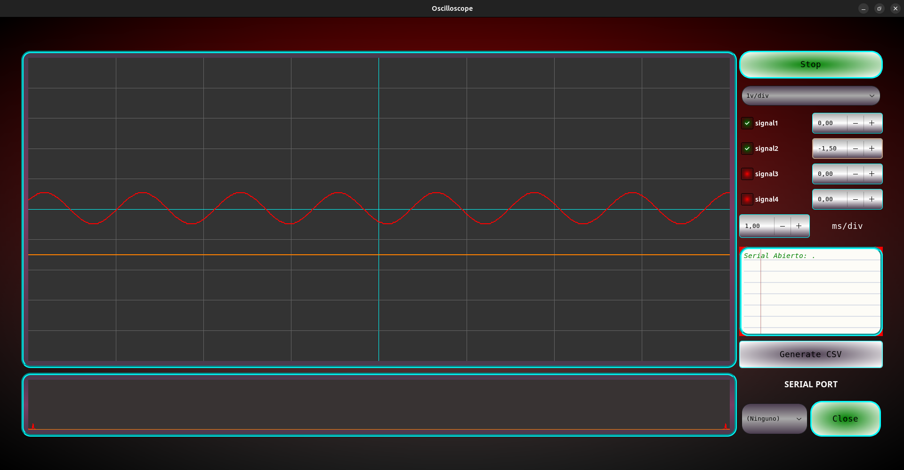
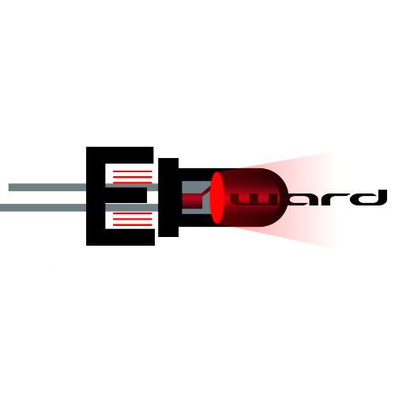

<h1>
    OSCILLOSCOPE
</h1>

<p align="center">
    
</p>

https://www.youtube.com/playlist?list=PLEoHO-IssPPAtG2c3IKp_-9pR1gyZFhW2

## DESCRIPTION
This project borns from the need for an affordable, versatile and easy-to-opearte oscilloscope, also it is open-source, for  to observe the voltage signals and analyze their spectrums in real time. Thereby providing an option for anyone who lacks an expensive instrument for their electronics laboratory.

It currently works with four signals, depending on the external device.

If you want to use it, follow the steps below...

## INSTALATION
Verify the architecture:  
```dpkg --print-architecture```

Update the repositories:  
```sudo apt update```

Check for the availability of GTK3 and GTK4:  
```apt-cache policy libgtk-3-0 libgtk-4-1```

Import public key:  
```gpg --import clave-publica-osc.asc```

Install the most recent candidate according to its architecture.  
//~~~~~~~~~~~~~~~~~~~~~~~~~~~~~~~~~~~~~~~~~~~~~~~~~~~~~~~~~~~~~~~~~~~~~~~~~

Download one package:  

Osciloscope-gtk4-amd64.deb  
Osciloscope-gtk4-arm64.deb  
Osciloscope-gtk4-armhf.deb  
Osciloscope-gtk4-i386.deb  
Osciloscope-gtk3-amd64.deb  
Osciloscope-gtk3-arm64.deb  
Osciloscope-gtk3-armhf.deb  
Osciloscope-gtk3-i386.deb  

Verification:  
```gpg --verify SHA256SUMS.asc SHA256SUMS```  
```sha256sum --check SHA256SUMS```

Install the correspond package:  
```sudo apt install ./Osciloscope-gtk4-amd64.deb```  
```sudo apt install ./Osciloscope-gtk4-arm64.deb```  
```sudo apt install ./Osciloscope-gtk4-armhf.deb```  
```sudo apt install ./Osciloscope-gtk4-i386.deb```  
```sudo apt install ./Osciloscope-gtk3-amd64.deb```  
```sudo apt install ./Osciloscope-gtk3-arm64.deb```  
```sudo apt install ./Osciloscope-gtk3-armhf.deb```  
```sudo apt install ./Osciloscope-gtk3-i386.deb```  


<p align="center">
    
</p>
