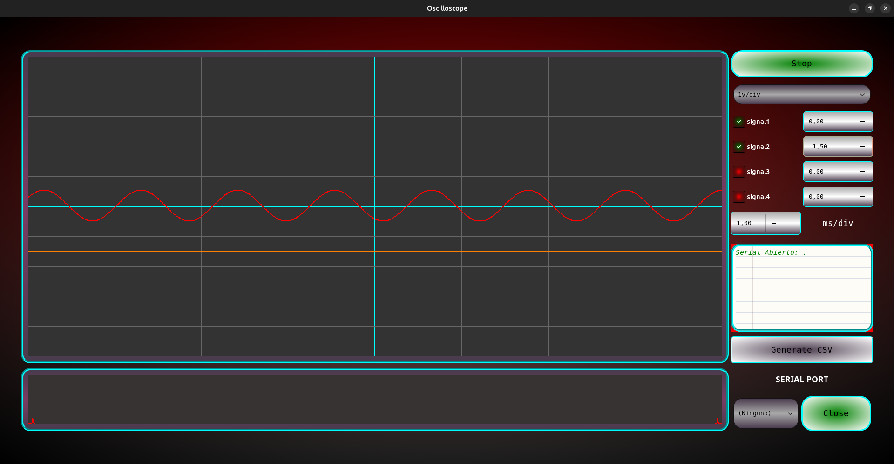
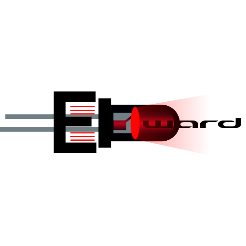

<h1>
    OSCILLOSCOPE
</h1>

<p align="center">
    
</p>

https://www.youtube.com/playlist?list=PLEoHO-IssPPAtG2c3IKp_-9pR1gyZFhW2

## DESCRIPTION
This project borns from the need for an affordable, versatile and easy-to-opearte oscilloscope, also it is open-source, for  to observe the voltage signals and analyze their spectrums in real time, thereby providing an option for anyone who lacks an expensive instrument for their electronics laboratory.

It currently works with four signals, depending on the external device.

If you want to use it, follow the steps below...

## INSTALATION
Verify the architecture:  
```bash dpkg --print-architecture```

Update the repositories:  
```bash sudo apt update```

Check for the availability of GTK3 and GTK4:  
```bash apt-cache policy libgtk-3-0 libgtk-4-1```


Install the most recent candidate according to its architecture.  
//~~~~~~~~~~~~~~~~~~~~~~~~~~~~~~~~~~~~~~~~~~~~~~~~~~~~~~~~~~~~~~~~~~~~~~~~~

Download --> oscilloscope-gtk4-armhf.deb  
Install --> ```sudo apt install oscilloscope-gtk4-armhf.deb```


Download --> oscilloscope-gtk3-armhf.deb  
Install --> ```sudo apt install oscilloscope-gtk3-armhf.deb```


Download --> oscilloscope-gtk4-arm64.deb  
Install --> ```sudo apt install oscilloscope-gtk4-arm64.deb```


Download --> oscilloscope-gtk3-arm64.deb  
Install --> ```sudo apt install oscilloscope-gtk3-arm64.deb```


Download --> oscilloscope-gtk4-amd64.deb  
Install --> ```sudo apt install oscilloscope-gtk4-amd64.deb```


Download --> oscilloscope-gtk3-amd64.deb  
Install --> ```sudo apt install oscilloscope-gtk3-amd64.deb```


Download --> oscilloscope-gtk4-i386.deb  
Install --> ```sudo apt install oscilloscope-gtk4-i386.deb```


Download --> oscilloscope-gtk3-i386.deb  
Install --> ```sudo apt install oscilloscope-gtk3-i386.deb```


<p align="center">
    
</p>
